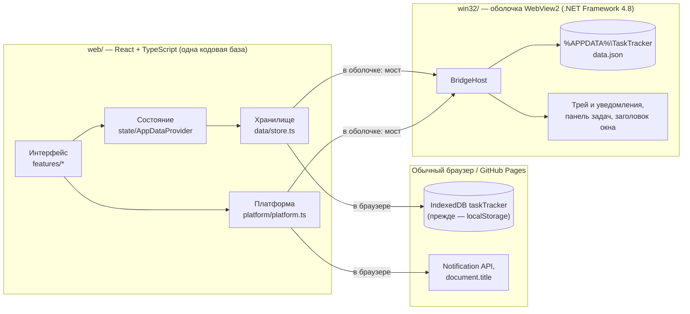
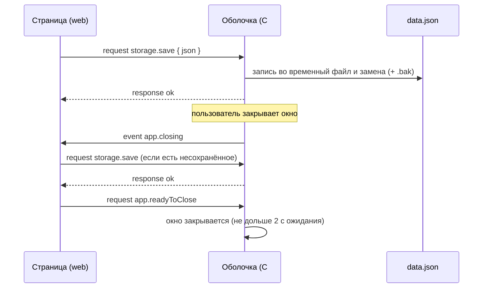

# Архитектура Task Tracker

Гибридная схема (решение — [дорожная карта](roadmap.md), реализация — [фаза 0](phase-0.md)): весь интерфейс и логика живут в веб-приложении `web/`, а приложение для Windows — тонкая оболочка `win32/`, которая показывает тот же веб-интерфейс во встроенном Edge (WebView2) и даёт ему доступ к возможностям Windows.

## Как это устроено

Какой путь выбрать, решает `createEnvironment()` в `web/src/platform/platform.ts`: если на странице есть `window.chrome.webview`, приложение работает внутри оболочки, и хранилище с платформенными функциями идут через мост; иначе используются API браузера. Остальной код об этом не знает.

## Веб-приложение (`web/`)

| Слой | Где | Что делает |
|---|---|---|
| Модель и формат данных | `src/data/model.ts`, `normalize.ts`, `schema.ts` | Типы задач, папок и заметок, секретов, настроек; «очистка» любых входных данных; номер схемы и миграции |
| Хранилище | `src/data/store.ts`, `idb.ts` | Единый интерфейс `DataStore`; реализации: IndexedDB (браузер), localStorage (запасной вариант и источник переноса), оболочка (мост), память |
| Импорт и экспорт | `src/data/exchange.ts`, `legacy.ts` | Экспорт в JSON (секреты по выбору), импорт экспорта и нативного `data.json`, перенос из прежней веб-версии |
| Состояние | `src/state/AppDataContext.tsx`, `ops.ts` | Данные в React-контексте; изменения — чистые функции над копией; сохранение с задержкой 300 мс и принудительно, когда страница скрывается или закрывается |
| Платформа | `src/platform/platform.ts` | Уведомления, заголовок окна, прогресс на панели задач, внешние ссылки, сигнал о закрытии |
| Тема | `src/theme/` | Палитра из пары «фон + акцент» → CSS-переменные; режимы системная, светлая, тёмная, своя, случайная, сохранённая |
| Функции | `src/features/` | Доски, детали задачи, Pomodoro, «Пространство», настройки |
| Рабочие пространства | `src/tabs.ts`, `src/features/layout/`, `App.tsx` | Реестр вкладок (id и порядок — `WORKSPACE_TABS` в модели, названия — `tabs.ts`); переключатель и окно настройки рабочих пространств. Пространства хранятся в данных (`settings.workspaces`), выбранное — на устройстве |
| Бэклог и цели | `src/features/backlog/`, `ops.ts` | Задачи на потом (признак `backlog`: такие задачи не показываются на досках и всегда в TODO), «Взять на сегодня», долгосрочные цели с необязательным сроком; прогресс цели — доля выполненных задач с её `goalId`. Задача привязывается к цели и откладывается в бэклог в панели деталей |
| Карточки | `src/features/cards/`, `data/scheduler.ts`, `data/cloze.ts` | Колоды, карточки «вопрос — ответ» и с пропусками, повторение по FSRS (ts-fsrs). Очередь на сегодня — чистые функции в `queue.ts`; учебный день с 4:00. Вкладка и диалог «карточка из заметки» — отдельные части сборки |
| Пространство знаний | `src/features/knowledge/`, `features/workspace/` | Дерево папок и заметок с перетаскиванием; редактор Markdown на CodeMirror 6; просмотр через markdown-it с плагином формул KaTeX (`math.ts`). Редактор и просмотр — отдельные части сборки, загружаются при открытии заметки. В заметках не выполняется HTML, картинки не загружаются из сети (показываются ссылками), ссылки открываются в системном браузере. Поиск: полнотекстовый на MiniSearch (`fulltext.ts`, индекс обновляется только для изменённых заметок) и RegEx в Web Worker с остановкой через 1 с (`regex.ts`, `regex.worker.ts`, `regexRunner.ts`). Связи с задачами: `NoteTasks.tsx` в заметке, `features/details/TaskNotes.tsx` в деталях задачи; переход к заметке из задачи идёт через `App.tsx` (вкладка «Пространство» открывается с нужной заметкой) |

Правила кода: TypeScript в строгом режиме, правила React Compiler в ESLint (никаких `Date.now()` и `Math.random()` при рендере, данные меняются только через `apply()`), тесты Vitest рядом с кодом. Перед коммитом — `npm run check`.

## Данные

- Формат — объект `AppData` (`web/src/data/model.ts`) с полем `schemaVersion`. Он совпадает с прежним нативным `data.json` (версия схемы 0), поэтому старые файлы читаются без конвертации.
- Изменение формата: увеличить `CURRENT_SCHEMA_VERSION` в `schema.ts` и добавить миграцию с предыдущей версии. Данные из более новой версии приложения открываются только для чтения и не перезаписываются.
- Версии схемы: 0 — прежний нативный `data.json`; 1 — v2.0.0; 2 — v2.1.0, пространство знаний: папки (`folders`), у заметок — папка (`folderId`) и связанные задачи (`taskIds`); 3 — v2.2.0, карточки: `decks`, `cards` (расписание FSRS на каждый элемент повторения), `reviews` (история ответов, не больше 20 000 записей), `settings.newCardsPerDay`; 4 — v2.3.0: рабочие пространства (`settings.workspaces`), счётчики активности по календарным дням (`activity`, файл `data/activity.ts`), время выполнения задачи (`doneAt`); 5 — v2.4.0: цели (`goals`), у задач — признак бэклога (`backlog`) и цель (`goalId`), в пространство «Основное» добавляется вкладка «Бэклог». Связь заметки с задачей хранится только в заметке; при удалении задачи заметка остаётся, исчезает только связь. Нормализация чинит ссылки на несуществующие папки и задачи и разрывает циклы папок.
- Где лежат: в браузере — база IndexedDB `taskTracker`, ключ `data` (с v2.1.0: в localStorage помещается около 5 МБ). При первом запуске v2.1.0 данные переносятся из ключа localStorage `taskTracker.data`, сам ключ не трогается; ещё более старые ключи `taskTracker.*` только читаются. Если IndexedDB не открывается, сессия работает с localStorage. В оболочке — `%APPDATA%\TaskTracker\data.json` (атомарная запись, копия предыдущей версии в `data.json.bak`).
- Секреты хранятся в открытом виде — [docs/secrets-policy.md](secrets-policy.md).

## Мост веб ↔ оболочка

Полный контракт — [bridge-protocol.md](bridge-protocol.md), типы — `web/src/bridge/protocol.ts`, реализация в оболочке — `win32/src/BridgeHost.cs`.

Сохранение и закрытие окна:

## Оболочка Windows (`win32/`)

- Веб-сборка лежит рядом с exe в папке `web\` и отдаётся с виртуального домена `https://app.local` — без сервера и без интернета.
- Безопасность: переход на любой другой адрес отменяется, ссылка открывается в браузере по умолчанию; сообщения моста принимаются только от своей страницы; автозаполнение и сохранение паролей в WebView2 выключены; профиль браузера — в `%LOCALAPPDATA%\TaskTracker\WebView2`.
- Разработка: переменная `TASKTRACKER_DEV_URL=http://localhost:5173` показывает dev-сервер Vite с горячей перезагрузкой и включает инструменты разработчика.

## Сборка и выпуск

| Что | Как |
|---|---|
| Веб локально | `cd web` → `npm ci` → `npm run dev` / `npm run build` |
| Windows локально | `win32\build.cmd` → `win32\dist\TaskTracker\` и `TaskTracker.zip` |
| Проверки | GitHub Actions `ci.yml` на каждый push и PR: веб (типы, линтер, формат, тесты, сборка), Windows (сборка, пакет, актуальность `THIRD_PARTY_NOTICES.md`) |
| Выпуск | тег `vX.Y.Z` → `release.yml` публикует GitHub Release с zip для Windows и для веба |
| Веб онлайн | `pages.yml` → GitHub Pages (включается владельцем репозитория) |
| Зависимости | закреплены lock-файлами; Dependabot раз в неделю; лицензии — правила D-01…D-06 в ТЗ и `THIRD_PARTY_NOTICES.md` (генерирует `tools/third-party-notices.mjs`) |

## Как добавить функцию

1. Реализовать её в `web/` (данные — через `ops.ts` и при необходимости новую версию схемы; интерфейс — в `features/`), с тестами.
2. Если нужна возможность Windows, которой нет в браузере, — добавить метод в `web/src/bridge/protocol.ts`, обработчик в `win32/src/BridgeHost.cs` и строку в [bridge-protocol.md](bridge-protocol.md); в браузерной реализации `Platform` предусмотреть запасной вариант.
3. Новая библиотека — по правилам D-01…D-06; после установки обновить уведомления: `node tools/third-party-notices.mjs`.
